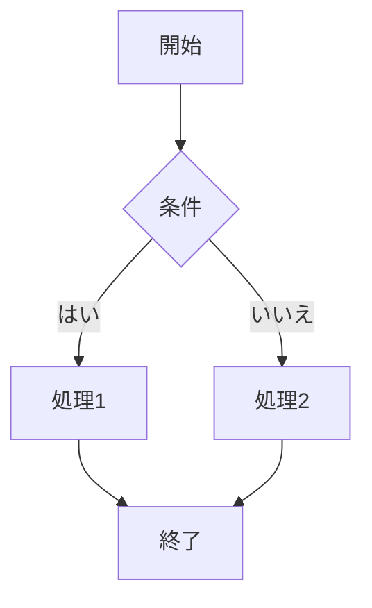

# アンカーリンクテスト（移動先）

このファイルは [anchor-link-test.md](anchor-link-test.md) のリンクの移動先です。直接開いた場合はページの先頭が表示されます。

アンカーまでの距離を確保するため、以下にダイアグラム・数式・本文を配置しています。

---

## 描画で高さが変わる要素

Mermaidダイアグラムは描画後に高さが変わります。

KaTeXの数式も描画後に高さが変わります（右上の「TeX」ボタンがONの場合）。

$$
f(x) = \int_{-\infty}^{\infty} \hat{f}(\xi)\, e^{2 \pi i \xi x} \, d\xi
$$

---

## 本文（距離の確保）

### セクション 1

この段落は、アンカーまでのスクロール距離を確保するためのものです。画面の高さより長い距離があれば、移動したかどうかを目で確認できます。

### セクション 2

この段落は、アンカーまでのスクロール距離を確保するためのものです。画面の高さより長い距離があれば、移動したかどうかを目で確認できます。

### セクション 3

この段落は、アンカーまでのスクロール距離を確保するためのものです。画面の高さより長い距離があれば、移動したかどうかを目で確認できます。

### セクション 4

この段落は、アンカーまでのスクロール距離を確保するためのものです。画面の高さより長い距離があれば、移動したかどうかを目で確認できます。

### セクション 5

この段落は、アンカーまでのスクロール距離を確保するためのものです。画面の高さより長い距離があれば、移動したかどうかを目で確認できます。

### セクション 6

この段落は、アンカーまでのスクロール距離を確保するためのものです。画面の高さより長い距離があれば、移動したかどうかを目で確認できます。

### セクション 7

この段落は、アンカーまでのスクロール距離を確保するためのものです。画面の高さより長い距離があれば、移動したかどうかを目で確認できます。

### セクション 8

この段落は、アンカーまでのスクロール距離を確保するためのものです。画面の高さより長い距離があれば、移動したかどうかを目で確認できます。

---

**明示的なアンカー**: テストケース1のリンクで、この段落が画面の上端に表示されます。

---

## Target heading

テストケース2のリンクで、この見出しが画面の上端に表示されます。

---

## 日本語の見出し

テストケース3のリンクで、この見出しが画面の上端に表示されます。

---

### 末尾の余白

最後のアンカーも画面の上端まで移動できるように、余白を設けています。

&nbsp;

&nbsp;

&nbsp;

&nbsp;

&nbsp;

&nbsp;

&nbsp;

&nbsp;
